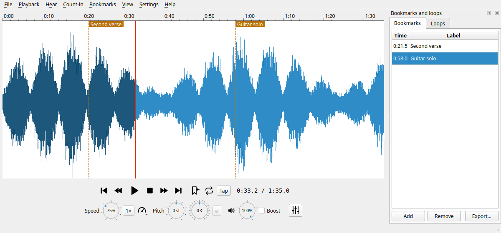

py-slowdown
===========

py-slowdown plays audio slower or faster without changing its pitch. It is
meant for transcribing recordings (lectures, interviews, dictations) and for
learning music by ear: the file is shown as a waveform, the usual player
controls move through it, and bookmarks keep the places one wants to come
back to.

*Leer en español: [README_es.md](README_es.md).*

What it does
------------

- Opens audio files and the sound of video files: MP3, M4A/AAC, MP4,
  FLAC, WAV, AIFF, Ogg, Opus, WMA and whatever else FFmpeg reads. Files
  with more than two channels are mixed down to stereo.
- Shows the audio as a waveform, with a time ruler. A click moves the
  position there; Ctrl+wheel zooms around the pointer, the wheel scrolls.
  A long file can be played while it is still being read.
- Play, pause, stop, go to the start or to the end, back and forward (by a
  skip length chosen in Settings, 1 to 60 seconds; hold the button to keep
  going), and one second back or forward.
- Speed from 0.25× to 3×, changed while it plays, with the pitch kept. The
  stretching is done by the [Rubber Band Library](https://breakfastquay.com/rubberband/),
  with its R3 ("finer") engine, its highest quality, called through a small
  binding of py-slowdown's own. At 1× the file is
  played as it is, sample for sample, without going through Rubber Band.
- Bookmarks at the playing position (B), or anywhere with a right click on
  the waveform; each can have a label. They are listed in a side panel,
  drawn on the waveform, and can be exported as a text file. Ctrl+← and
  Ctrl+→ go to the previous and next bookmark.
- Remembers, for each file, its bookmarks and the point where it was left,
  and goes on from there the next time.
- Interface in English and in Spanish (Settings > Language).

Keyboard
--------

| Action                         | Keys                             |
|--------------------------------|----------------------------------|
| Play / pause                   | Space                            |
| Stop and go back to the start  | S                                |
| Go to the start / end          | Home / End                       |
| Back / forward (skip length)   | ← / →                            |
| One second back / forward      | Shift+← / Shift+→                |
| Slower / faster (0.05×)        | ↓ / ↑, or − / +                  |
| Normal speed                   | N                                |
| Add a bookmark                 | B                                |
| Previous / next bookmark       | Ctrl+← / Ctrl+→, PgUp / PgDn     |
| Zoom in / out / whole file     | Ctrl++ / Ctrl+− / Ctrl+0         |
| Open a file                    | Ctrl+O                           |

Installing
----------

Each release, on [GitHub](https://github.com/nivaca/py-slowdown/releases)
and [Codeberg](https://codeberg.org/nivaca/py-slowdown/releases), has
installers that carry all the program needs (their own Python, Qt, FFmpeg
and Rubber Band), so nothing else has to be installed:

- **Windows** 10 or later: `py-slowdown-VERSION-windows-x64-setup.exe`. It
  installs for you alone, without administrator's rights (or for everyone,
  if you choose so), with a Start-menu entry and "Open with" for audio
  files. The installer is not signed by Microsoft: if SmartScreen stops it,
  choose *More info > Run anyway*.
- **macOS** 13 or later: `py-slowdown-VERSION-macos-arm64.dmg` (Apple
  Silicon) or `-macos-x86_64.dmg` (Intel). Drag py-slowdown to
  Applications. It is not notarized by Apple: the first time, choose *Open
  Anyway* in System Settings > Privacy & Security.
- **Linux**: an RPM for Fedora (also in Copr: `sudo dnf copr enable
  nivaca/py-slowdown` and `sudo dnf install py-slowdown`), which uses
  Fedora's Rubber Band, PortAudio and ffmpeg; a Debian package for Debian
  12, Ubuntu 22.04 and later; and, for any Linux with glibc 2.34 or later,
  an installer (`sh py-slowdown-VERSION-linux-x86_64.run`, for you alone,
  or with sudo for everyone, with a menu entry and an uninstaller) and an
  AppImage, which needs no installing.
- The wheel and the source, for installing with pip.

Every file is signed with the key in `packaging/RPM-GPG-KEY-py-slowdown`
(`FILE.asc`, and `SHA256SUMS` with its signature; those of the installers
for Windows and macOS, which GitHub makes, in `SHA256SUMS-installers`):
`gpg --import RPM-GPG-KEY-py-slowdown`, then `gpg --verify FILE.asc FILE`.

From the source, with Python 3.14 or later, `install/install.sh` installs it
for one user on Linux or macOS, in an environment of its own, with a menu
entry (`--uninstall` removes it). It needs the Rubber Band Library (version
3 or later) and, on Linux, PortAudio from the system: `sudo dnf install
rubberband-libs portaudio` on Fedora, `sudo apt install librubberband2
libportaudio2` on Debian and Ubuntu, `brew install rubberband` on macOS.

To run it from the source, with [uv](https://docs.astral.sh/uv/):

    uv run py-slowdown [FILE]

The tests: `uv run python tools/test.py` (each file in a process of its
own, at once), or `uv run pytest`. How a release is made is told in
[packaging/RELEASING.md](packaging/RELEASING.md).

Documentation
-------------

- The user manual: [docs/MANUAL_en.pdf](docs/MANUAL_en.pdf) (in Spanish,
  [docs/MANUAL_es.pdf](docs/MANUAL_es.pdf)); `man py-slowdown` once the
  RPM or the Debian package is installed.
- How it was made: [docs/DESCRIPTION.md](docs/DESCRIPTION.md).
- The open-source software it uses, with its licences:
  [docs/THIRD-PARTY.md](docs/THIRD-PARTY.md).
- The changes of each version: [CHANGELOG.md](CHANGELOG.md).

Where things are kept
---------------------

- Bookmarks and positions: `bookmarks.json`, by the full path of each audio
  file, in `~/.local/share/py-slowdown/` on Linux (`$XDG_DATA_HOME`),
  `%APPDATA%\py-slowdown` on Windows and `~/Library/Application
  Support/py-slowdown/` on macOS. A file that is moved or renamed loses
  them.
- Settings (window, volume, skip length, language, recent files):
  `~/.config/py-slowdown/py-slowdown.conf` on Linux, the registry
  (`HKEY_CURRENT_USER\Software\py-slowdown`) on Windows, and
  `~/Library/Preferences/com.py-slowdown.py-slowdown.plist` on macOS.
- While a file is open, its decoded samples are kept in an unnamed
  temporary file in the cache folder (`~/.cache/py-slowdown/`,
  `%LOCALAPPDATA%\py-slowdown\cache`, `~/Library/Caches/py-slowdown/`),
  which disappears when the file is closed (two hours of stereo take about
  2.5 GB there, but only what is read stays in memory).

Uninstalling the program never removes them.

License
-------

py-slowdown is free software, under the GNU General Public License,
version 3 or later (see [LICENSE](LICENSE)). It uses the Rubber Band
Library (GPL 2 or later), PortAudio (MIT), PyAV (BSD) with FFmpeg (LGPL 2.1
or later), PySide6 (LGPL 3), sounddevice (MIT) and NumPy (BSD), all of them
compatible with that licence. The AppImage and the Debian package carry a
Rubber Band compiled from its source, which is published with each release.

Nicolas Vaughan &lt;nicolasvaughan@proton.me&gt;
