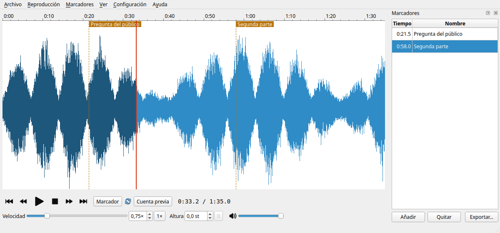

py-slowdown
===========

py-slowdown reproduce audio más lento o más rápido sin cambiarle la altura.
Está hecho para la música: para practicar una pieza y sacarla de oído,
oyendo un pasaje una y otra vez a una velocidad que se pueda seguir. El
archivo se ve como una forma de onda, los mandos de siempre lo recorren y
los marcadores guardan los lugares a los que se quiere volver.

Es un programa para la música, no para transcribir la voz hablada (clases,
entrevistas, dictados): lo que hace además de reproducir, como la cuenta
previa, el tempo o la altura en semitonos, está pensado para músicos.

*Read in English: [README.md](README.md).*

Lo que hace
-----------

- Abre archivos de audio y el sonido de los de video: MP3, M4A/AAC, MP4,
  FLAC, WAV, AIFF, Ogg, Opus, WMA y lo demás que lea FFmpeg. Los que tienen
  más de dos canales se mezclan en estéreo.
- Muestra el audio como forma de onda, con una regla de tiempos. Un clic
  lleva allí la posición; Ctrl+rueda acerca o aleja alrededor del puntero,
  y la rueda corre la vista. Un archivo largo se puede tocar mientras
  todavía se lee.
- Tocar, pausar, detener, ir al principio o al final, atrás y adelante (un
  salto que se elige en Configuración, de 1 a 60 segundos; con el botón
  apretado sigue saltando) y un segundo atrás o adelante. Una pausa lleva
  la posición de vuelta adonde empezó a tocar, para que Espacio toque otra
  vez el mismo pasaje; Mayús+Espacio sigue, en cambio, desde la pausa.
- Velocidad de 0,25× a 3× (de 25 a 300 %, en una perilla), que se cambia mientras suena, sin que cambie la
  altura. El estiramiento lo hace la [biblioteca Rubber Band](https://breakfastquay.com/rubberband/),
  con su motor R3 («finer»), el de más calidad, por medio de un enlace
  pequeño, propio de py-slowdown. A 1× el archivo suena tal
  cual, muestra por muestra, sin pasar por Rubber Band. El botón del velocímetro
  tiene una lista de velocidades propia (50 %, 75 %, 100 %, 125 %…). Se
  puede elegir una calidad más liviana (la mitad del procesador) o el motor anterior, R2, de
  ataques nítidos (Configuración > Calidad de la reproducción).
- Marcadores en la posición que suena (B), o en cualquier punto con el clic
  derecho sobre la forma de onda; cada uno puede llevar un nombre. Se
  listan en un panel lateral, se dibujan sobre la forma de onda y se pueden
  exportar a un archivo de texto. Ctrl+← y Ctrl+→ van al marcador anterior
  y al siguiente.
- Sube o baja la altura, en semitonos (de −12 a +12) y cents (centésimas
  de semitono, de −50 a +50, para afinar una grabación con un
  instrumento), cada uno con su perilla, sin cambiar la velocidad,
  también mientras suena; con Reproducción > Conservar los formantes, una voz o un instrumento conserva
  su timbre.
- Un ecualizador de cinco bandas, con perillas (el botón de los tres
  deslizadores, u Oír >
  Ecualizador).
- Oye una parte de la mezcla (Oír): un canal, los dos en uno, la mezcla sin
  su centro (donde suelen estar la voz y el solo), solo los graves, o todo
  menos los graves.
- Repite una selección sin fin y sin pausa (Mayús+arrastrar sobre la
  forma de onda, o I y O, y luego L): el final del pasaje entra en su
  principio con un fundido breve, a cualquier velocidad; sin nada
  seleccionado, se repite el archivo entero. Las selecciones se
  pueden guardar como bucles con un nombre (Mayús+L), para repetirlas de
  nuevo con un doble clic.
- Cuenta antes de tocar, como un metrónomo (C): se eligen cuántos golpes
  y el tempo, que puede seguir la velocidad; el tempo se puede medir
  marcando el pulso (T). Con el primer pulso de la grabación marcado
  (Cuenta previa > El primer pulso está aquí, Mayús+C), un marcador propio
  que se guarda con los demás, la grabación entra en el pulso más cercano,
  empiece donde empiece.
- Exporta la grabación, o la selección, como suena (a la velocidad y la
  altura elegidas, y como se oye, si se pide): WAV, FLAC, MP3 u Opus
  (Archivo > Exportar el audio, Ctrl+E).
- Recuerda, por archivo, sus marcadores, sus bucles, el punto donde se dejó
  y cómo se tocó (velocidad, altura, manera de oír, selección, cuenta
  previa), y la vez siguiente sigue desde allí, con toda su forma de onda
  enseguida. Todo eso se escribe además en un archivo con el nombre de la
  grabación y la extensión `.slx` (`canción.slx` para `canción.mp3`), junto
  a ella o en una carpeta elegida, de modo que viaja con la grabación;
  abrir el `.slx` abre la grabación. Archivo > Guardar el .slx (Ctrl+S)
  lo escribe enseguida. Archivo > Importar de Transcribe! abre un archivo
  de Transcribe! (`.xsc`), y también Archivo > Abrir: su grabación llega con sus marcadores (las secciones, los compases con nombre, el
  primer pulso y el tempo), sus bucles, su selección, su velocidad y su
  afinación, que desde entonces guarda su `.slx`. También puede reabrir el último
  archivo al empezar (Configuración > Reabrir el último archivo al
  empezar).
- Los atajos de teclado se pueden cambiar (Configuración > Atajos de
  teclado), también para un pedal de pie que mande teclas.
- Interfaz en inglés y en español (Configuración > Idioma).

Teclado
-------

| Acción                            | Teclas                           |
|-----------------------------------|----------------------------------|
| Tocar / pausar (y volver)         | Espacio                          |
| Seguir desde la pausa             | Mayús+Espacio                    |
| Detener y volver al principio     | S                                |
| Ir al principio / al final        | Inicio / Fin                     |
| Atrás / adelante (el salto)       | ← / →                            |
| Un segundo atrás / adelante       | Mayús+← / Mayús+→                |
| Más lento / más rápido (0,05×)    | ↓ / ↑, o − / +                   |
| Velocidad normal                  | N                                |
| Añadir un marcador                | B                                |
| Marcador anterior / siguiente     | Ctrl+← / Ctrl+→, RePág / AvPág   |
| Acercar / alejar / todo           | Ctrl++ / Ctrl+− / Ctrl+0         |
| Acercar a la selección            | Z                                |
| Un semitono más agudo / grave     | Ctrl+↑ / Ctrl+↓                  |
| Altura original                   | Mayús+N                          |
| Deshacer los cambios del sonido   | Ctrl+Mayús+N                     |
| Repetir la selección              | L                                |
| Seleccionar                       | Mayús+arrastrar, o I y O         |
| Quitar la selección               | Esc                              |
| Seleccionar el archivo entero     | Ctrl+A                           |
| Guardar la selección como bucle   | Mayús+L                          |
| Contar antes de tocar             | C                                |
| Marcar el tempo (con el pulso)    | T                                |
| El primer pulso está aquí         | Mayús+C                          |
| Abrir un archivo                  | Ctrl+O                           |
| Cerrar el archivo (sigue abierto) | Ctrl+W                           |
| Salir                             | Alt+F4, Ctrl+Q                   |
| Guardar el .slx                   | Ctrl+S                           |
| Exportar el audio                 | Ctrl+E                           |

Son las teclas de siempre; Configuración > Atajos de teclado las cambia.

Instalación
-----------

Cada versión, en [GitHub](https://github.com/nivaca/py-slowdown/releases) y
en [Codeberg](https://codeberg.org/nivaca/py-slowdown/releases), trae
instaladores que llevan todo lo que el programa necesita (su propio Python,
Qt, FFmpeg y Rubber Band), así que no hay que instalar nada más:

- **Windows** 10 o posterior: `py-slowdown-VERSIÓN-windows-x64-setup.exe`.
  Lo instala solo para usted, sin permisos de administrador (o para todos,
  si así lo elige), con su entrada en el menú Inicio y «Abrir con» para los
  archivos de audio; abre también los `.slx`. El instalador no está firmado por Microsoft: si
  SmartScreen lo detiene, elija *Más información > Ejecutar de todas
  formas*.
- **macOS** 13 o posterior: `py-slowdown-VERSIÓN-macos-arm64.dmg` (Apple
  Silicon) o `-macos-x86_64.dmg` (Intel). Arrastre py-slowdown a
  Aplicaciones. No está notarizado por Apple: la primera vez, elija *Abrir
  igualmente* en Ajustes del Sistema > Privacidad y seguridad.
- **Linux**: un RPM para Fedora (también en Copr: `sudo dnf copr enable
  nivaca/py-slowdown` y `sudo dnf install py-slowdown`), que usa el Rubber
  Band, el PortAudio y el ffmpeg de Fedora; un paquete de Debian para
  Debian 12, Ubuntu 22.04 y posteriores (también en el repositorio APT de mis
  programas, [github.com/nivaca/apt](https://github.com/nivaca/apt), para que
  `apt upgrade` traiga cada versión nueva), y, para cualquier Linux con glibc
  2.34 o posterior, un instalador (`sh py-slowdown-VERSIÓN-linux-x86_64.run`,
  para usted o, con sudo, para todos, con su entrada en el menú y un
  desinstalador) y una AppImage, que no necesita instalarse.
- El wheel y el código, para instalarlo con pip.

Todos los archivos van firmados con la clave de
`packaging/RPM-GPG-KEY-py-slowdown` (`ARCHIVO.asc`, y `SHA256SUMS` con su
firma; los de los instaladores para Windows y macOS, que hace GitHub, en
`SHA256SUMS-installers`): `gpg --import RPM-GPG-KEY-py-slowdown` y luego
`gpg --verify ARCHIVO.asc ARCHIVO`.

Desde el código, con Python 3.14 o posterior, `install/install.sh` lo
instala para un usuario en Linux o en macOS, en un entorno propio, con su
entrada en el menú (`--uninstall` lo quita). Necesita del sistema la
biblioteca Rubber Band (versión 3 o posterior) y, en Linux, PortAudio:
`sudo dnf install rubberband-libs portaudio` en Fedora, `sudo apt install
librubberband3 libportaudio2` en Debian y Ubuntu (`librubberband2` en las versiones anteriores), `brew install rubberband`
en macOS.

Para correrlo desde el código, con [uv](https://docs.astral.sh/uv/):

    uv run py-slowdown [ARCHIVO]

Las pruebas: `uv run python tools/test.py` (cada archivo en un proceso
propio, todos a la vez), o `uv run pytest`. Cómo se publica una versión
está en [packaging/RELEASING.md](packaging/RELEASING.md).

Documentación
-------------

- El manual de usuario: [docs/MANUAL_es.pdf](docs/MANUAL_es.pdf) (en
  inglés, [docs/MANUAL_en.pdf](docs/MANUAL_en.pdf)); `man py-slowdown` una
  vez instalado el RPM o el paquete de Debian.
- Su descripción: [docs/DESCRIPCIÓN_es.md](docs/DESCRIPCI%C3%93N_es.md).
- El software de código abierto que usa, con sus licencias:
  [docs/TERCEROS_es.md](docs/TERCEROS_es.md).
- Los cambios de cada versión: [CHANGELOG_es.md](CHANGELOG_es.md).

Dónde se guarda todo
--------------------

- Cómo se tocó cada grabación, con sus marcadores y bucles, en un archivo
  con su nombre (`canción.slx`, en XML), junto a ella, o en la carpeta
  elegida en Configuración > Archivos de ajustes de cada grabación (o en
  ninguna). Los de la versión 1.2.0 (`canción.xml`) se leen todavía, y se
  reemplazan.
- Marcadores, bucles, posiciones y cómo se tocó cada archivo:
  `bookmarks.json`, por la ruta completa de cada
  archivo de audio, en `~/.local/share/py-slowdown/` en Linux
  (`$XDG_DATA_HOME`), `%APPDATA%\py-slowdown` en Windows y
  `~/Library/Application Support/py-slowdown/` en macOS. Si el archivo se
  mueve o se renombra, los pierde.
- Configuración (ventana, volumen, salto, idioma, archivos recientes,
  atajos de teclado, manera de oír, la última exportación):
  `~/.config/py-slowdown/py-slowdown.conf` en Linux, el registro
  (`HKEY_CURRENT_USER\Software\py-slowdown`) en Windows y
  `~/Library/Preferences/com.py-slowdown.py-slowdown.plist` en macOS.
- Mientras un archivo está abierto, sus muestras decodificadas van a un
  archivo temporal sin nombre en la carpeta de caché
  (`~/.cache/py-slowdown/`, `%LOCALAPPDATA%\py-slowdown\cache`,
  `~/Library/Caches/py-slowdown/`), que desaparece al cerrarlo (dos horas en
  estéreo ocupan allí unos 1,3 GB, pero en la memoria queda solo lo que se
  lee). Mientras un archivo largo se lee por partes, cada parte tiene otro
  allí, hasta que se añade (en Windows se llaman `part-…`).
- Las formas de onda de los últimos 200 archivos leídos, en la carpeta
  `peaks` de esa carpeta de caché (unos 4 MB por hora y media), para que
  toda la forma de onda esté apenas se vuelve a abrir un archivo. Se pueden
  borrar cuando se quiera.

Desinstalar el programa nunca los quita.

Licencia
--------

py-slowdown es software libre, bajo la Licencia Pública General de GNU,
versión 3 o posterior (véase [LICENSE](LICENSE)). Usa la biblioteca Rubber
Band (GPL 2 o posterior), PortAudio (MIT), PyAV (BSD) con FFmpeg (LGPL 2.1
o posterior), PySide6 (LGPL 3), sounddevice (MIT) y NumPy (BSD), todas
compatibles con esa licencia. La AppImage y el paquete de Debian llevan un
Rubber Band compilado de su código, que se publica con cada versión. Cómo
se escriben los marcadores en los archivos de Transcribe! se aprendió de
[Transcribe-xsc-file-converter](https://github.com/roryokane/Transcribe-xsc-file-converter), de Rory
O’Kane (BlueOak-1.0.0); no se usa nada de su código.

Nicolas Vaughan &lt;nicolasvaughan@proton.me&gt;
